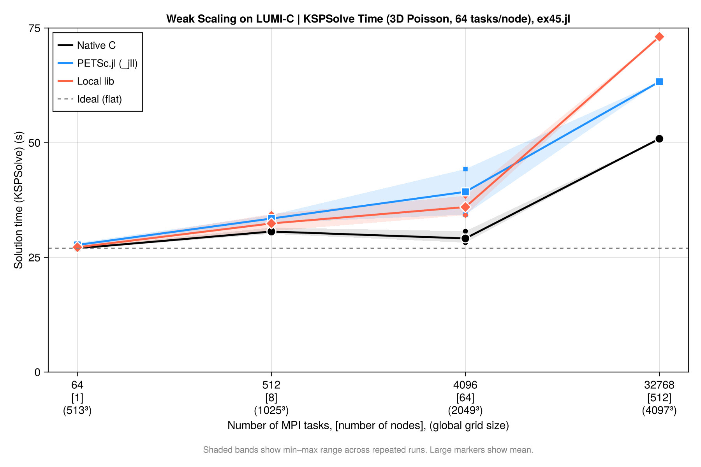

# Running on HPC Systems

On a cluster, PETSc.jl has to use the cluster's MPI, so that runs across nodes use its network. Three setups do that. They differ in where `libpetsc` comes from and how it reaches the system MPI:

| Setup | PETSc library | Path to the system MPI | Built on the cluster |
|---|---|---|---|
| 1. `PETSc_jll`, system MPI | prebuilt `PETSc_jll` | MPI.jl loads the system `libmpi` directly; `PETSc_jll` picks the build for its ABI | nothing |
| 2. `PETSc_jll`, MPItrampoline | prebuilt `PETSc_jll` (MPItrampoline build) | MPItrampoline forwards every MPI call to MPIwrapper, a small library built against the system MPI | MPIwrapper |
| 3. Local PETSc | your own `libpetsc.so` | PETSc links the system MPI itself | PETSc |

All three run the same Julia code; only the environment's preferences differ. Setup 1 needs nothing compiled and is the place to start. Setup 2 works with any MPI, whatever its ABI. Setup 3 is for external packages or GPU builds that `PETSc_jll` doesn't have, and for compiler flags tuned to the machine.

## 1. `PETSc_jll` with the system MPI

`PETSc_jll` comes in builds for several MPI ABIs (the standard MPI ABI, MPICH, Open MPI, MPItrampoline) and loads the one that matches the MPI that MPI.jl is configured to use. Pointing MPI.jl at the system MPI with MPIPreferences is all it takes.

Install the packages:
```julia
julia> ]
pkg> add MPI, MPIPreferences, PETSc
```

Then pick the case that matches the cluster's MPI (load its module first, so that its library and launcher are found):

- **An MPI with the standard ABI.** MPI 5.0 defines a standard ABI, which MPICH 5 implements when configured with `--enable-mpi-abi` (it installs `libmpi_abi.so`). Give the ABI explicitly; the automatic detection reports the implementation's own ABI:
  ```julia
  using MPIPreferences
  MPIPreferences.use_system_binary(; library_names = ["libmpi_abi"], abi = "MPIABI", mpiexec = "srun")
  ```
  `PETSc_jll` then loads its `mpiabi` build.
- **An MPICH-compatible MPI** (Cray MPICH, Intel MPI, MVAPICH, MPICH without the standard ABI). MPIPreferences detects the ABI:
  ```julia
  using MPIPreferences
  MPIPreferences.use_system_binary(; mpiexec = "srun")   # on Cray systems add vendor = "cray"
  ```
  `PETSc_jll` then loads its `mpich` build.
- **Open MPI**: the same call; `PETSc_jll` loads its `openmpi` build.

`mpiexec` names the launcher of the cluster (`srun` on SLURM, `mpiexec` elsewhere). The call writes the choice to `LocalPreferences.toml` of the active project. Some centers ship a Julia environment that already sets these preferences, through a `LocalPreferences.toml` on `JULIA_LOAD_PATH`; a project there uses the system MPI without any call.

## 2. `PETSc_jll` through MPItrampoline

[MPItrampoline](https://github.com/eschnett/MPItrampoline) defines an MPI ABI of its own and forwards each call at run time to [MPIwrapper](https://github.com/eschnett/MPIwrapper), which you compile once against the system MPI. This works for any MPI, also one whose ABI matches none of the `PETSc_jll` builds.

Build MPIwrapper with the cluster's MPI compiler wrappers:
```bash
git clone https://github.com/eschnett/MPIwrapper
cmake -S MPIwrapper -B MPIwrapper/build -DMPIEXEC_EXECUTABLE=$(which srun) \
    -DCMAKE_BUILD_TYPE=RelWithDebInfo -DCMAKE_INSTALL_PREFIX=$HOME/mpiwrapper
cmake --build MPIwrapper/build
cmake --install MPIwrapper/build
```

Select MPItrampoline in the project, overriding any system MPI the environment already sets:
```julia
using MPIPreferences
MPIPreferences.use_jll_binary("MPItrampoline_jll")
```

and point MPItrampoline at the wrapper in every job:
```bash
export MPITRAMPOLINE_LIB=$HOME/mpiwrapper/lib64/libmpiwrapper.so
```

`PETSc_jll` then loads its MPItrampoline build. Every MPI call goes through one more function call; in the results below this costs no measurable time in the solve.

## 3. A PETSc built on the cluster

The library must be a shared library (`--with-shared-libraries=1`), built with the cluster's MPI compiler wrappers, and the project's MPI.jl must use the same MPI (case 1 above). A mismatch between the MPI that PETSc was built against and the one MPI.jl loads crashes or hangs at the first MPI call.

A configure line with 64-bit indices and SuperLU_DIST for the coarse solve (set the architecture flags for the compute nodes' CPU, which can differ from the login node's):
```bash
./configure --prefix=$HOME/petsc/3.25.6-opt \
    --with-cc=mpicc --with-cxx=mpicxx --with-fc=0 \
    --with-debugging=0 COPTFLAGS="-O3 -march=native" CXXOPTFLAGS="-O3 -march=native" \
    --with-64-bit-indices=1 --with-precision=double --with-scalar-type=real \
    --with-shared-libraries=1 --with-blaslapack-dir=$OPENBLAS_DIR \
    --download-superlu_dist --download-metis --download-parmetis \
    --with-mpiexec=srun
make && make install
```

Then point PETSc.jl at it once, as described in [Using a custom PETSc build](@ref):
```julia
using PETSc
PETSc.set_library!("$(ENV["HOME"])/petsc/3.25.6-opt/lib/libpetsc.so"; PetscScalar = Float64, PetscInt = Int64)
```

This is also the way to GPU support on machines that `PETSc_CUDA_jll` has no build for, such as aarch64 (Grace Hopper) or AMD GPUs; see [GPU Support](gpu.md).

## Checking the setup

On the login node, in the project you'll run:
```julia
julia> using MPI, PETSc
julia> MPI.Get_library_version()   # the system MPI (setups 1 and 3) or MPItrampoline (setup 2)
julia> PETSc.library_info()        # PETSc_jll or the path of your own library
```

and check that a parallel launch works:
```julia
julia> mpiexec(cmd -> run(`$cmd -n 3 echo hello world`));
```

PETSc's own report confirms the library at run time: with `-log_view`, the header names the PETSc version and the number of processes, and the end lists the configure options of the library that was loaded.

## Running jobs

#### Precompile before the first parallel run

Run the project once on a single process (on the login node, or in a one-task job) after every package update:
```bash
julia --project=. -e 'using PETSc'
```
If the cache is stale when a job starts, every rank compiles at the same time; the job then hangs on the cache's lock file, at 0% CPU and without an error, until the time limit.

#### A job script

A SLURM script for setup 2; for setups 1 and 3 drop `MPITRAMPOLINE_LIB`:
```bash
#!/bin/bash
#SBATCH --nodes=8
#SBATCH --ntasks-per-node=64
#SBATCH --time=00:10:00

export MPITRAMPOLINE_LIB=$HOME/mpiwrapper/lib64/libmpiwrapper.so
# One thread per rank: BLAS and SuperLU_DIST otherwise start a thread per core in every rank
export OMP_NUM_THREADS=1
export OPENBLAS_NUM_THREADS=1

srun --cpu-bind=cores julia --project=$HOME/myproject ex45.jl \
    -Nx 1025 -Ny 1025 -Nz 1025 -pc_mg_levels 6 \
    -ksp_type cg -pc_type mg \
    -mg_levels_ksp_type chebyshev -mg_levels_pc_type jacobi \
    -mg_coarse_ksp_type preonly -mg_coarse_pc_type telescope \
    -mg_coarse_pc_telescope_reduction_factor 32 \
    -mg_coarse_telescope_pc_type lu -mg_coarse_telescope_pc_factor_mat_solver_type superlu_dist \
    -ksp_rtol 1e-8 -ksp_converged_reason -log_view
```

`--cpu-bind=cores` pins each rank to one core. On nodes with several sockets or NUMA domains, add `--distribution=block:cyclic` to spread the ranks over all of them, so that each rank gets its share of the memory bandwidth.

#### Check that every option was used

PETSc ignores options it doesn't recognize, so a misspelled option silently leaves the solver at its default. At the end of a run, PETSc lists every option that nothing read (`-options_left`, on by default):
```
There is one unused database option. It is:
Option left: name:-mg_coarse_telescope_reduction_factor value: 256 source: command line
```
(the correct name is `-mg_coarse_pc_telescope_reduction_factor`). `ex45.jl` reads `-Nx`, `-Ny` and `-Nz` itself, so PETSc lists those for the Julia runs; any other line is a mistake. Options passed to PETSc.jl as keyword arguments are not checked this way, so for benchmarks and production runs, pass the solver options on the command line and check the end of the output.

#### Start-up time

Loading Julia and PETSc.jl and compiling the code on first use adds a few seconds per run, independent of the number of ranks (about 3 to 5 s in the results below). It is paid once per run, not per solve or per time step. The MPI launch itself can cost much more on large jobs, for native PETSc and Julia alike: on some systems it grows with the number of ranks per node, to tens of seconds for a full node. Time a trivial MPI program at the job size you plan before reading wall-clock times as solver performance.

#### `mpiexec` from Julia inside a SLURM allocation

A program that starts MPI processes itself through MPI.jl's `mpiexec` with a JLL MPI (`MPICH_jll`, `MPIABI_jll`), such as PETSc.jl's own test suite, hangs inside `srun` or `salloc` until the time limit: MPICH's launcher tries to start a SLURM job step, which waits for the resources the allocation already holds. Set `HYDRA_LAUNCHER=fork` so that it starts the processes directly.

## Performance and weak scalability

The benchmark is [`ex45.jl`](https://github.com/JuliaParallel/PETSc.jl/blob/main/examples/dmda/ex45.jl), the 3D Poisson problem −Δu = f on the unit cube with a manufactured solution, solved with conjugate gradients and geometric multigrid: Chebyshev/Jacobi smoothing, and an LU coarse solve (SuperLU_DIST) on a 33³ grid, gathered onto 16 ranks with `PCTELESCOPE`. Each rank holds 128³ grid points, and the number of levels grows with the grid so that the coarse grid stays the same. The same problem runs three ways:

- **jll**: `ex45.jl` with `PETSc_jll` through MPItrampoline (setup 2),
- **local lib**: `ex45.jl` with a PETSc built on the cluster (setup 3),
- **native**: [`ex45_julia.c`](https://github.com/JuliaParallel/PETSc.jl/blob/main/examples/scalability_tests/ex45_julia.c), the same program in C, linked against the same local PETSc.

The runs below are on CSCS Daint (GH200 nodes, CPUs only, 64 ranks per node spread over the four Grace CPUs, Cray MPICH 8.1.32, PETSc 3.25.6 with 64-bit indices). Times are the median of three runs; the spread between runs was at most 3%.

| Ranks [nodes] | Grid | Iterations | KSPSolve native | local lib | jll | Total in PETSc, native / local lib / jll |
|---|---|---|---|---|---|---|
| 64 [1] | 513³ | 7 | 1.82 s | 1.85 s | 1.89 s | 3.5 / 6.9 / 7.1 s |
| 512 [8] | 1025³ | 8 | 2.08 s | 2.09 s | 2.16 s | 4.1 / 7.5 / 7.7 s |
| 4096 [64] | 2049³ | 8 | 2.24 s | 2.30 s | 2.29 s | 4.9 / 8.5 / 9.5 s |

- **The solve is the same in Julia and C.** KSPSolve with PETSc.jl is within 1 to 4% of native at every size, with either library. All three give the same iteration counts and errors.
- **Weak scaling:** from 1 to 64 nodes the native solve time grows from 1.82 to 2.24 s, an efficiency of 81% (93% from 8 to 64 nodes). Part of the step from 1 to 8 nodes is one more iteration. The rest is on the fine levels, which are limited by memory bandwidth, and by communication between nodes once the job spans several.
- **Julia's fixed cost:** the total time inside PETSc (from `PetscInitialize` to `PetscFinalize`) is 3.3 to 4.6 s longer with PETSc.jl, for compiling the Julia code on first use and assembling the operators in Julia. It hardly depends on the number of ranks.

Earlier runs on LUMI-C with SOR smoothing are shown below. The coarse-solve option in those runs was misspelled, so the coarse LU ran on all ranks, and the KSPSolve time of the `ex45.jl` used then also included assembling the multigrid operators in Julia. Both make the gap to native look larger than it is.


